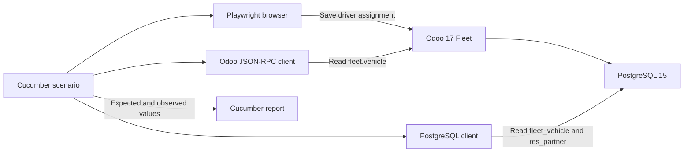

# Framework architecture

Cucumber runs Gherkin scenarios against Odoo 17 Community and PostgreSQL 15. The driver-assignment scenario saves the
assignment in the real Fleet UI, reads the vehicle through Odoo JSON-RPC and independently reads the driver relationship
from PostgreSQL. The two read-back steps attach their expected and observed values to the same Cucumber result.

## Code and execution

- [Feature files](../features/) describe the workflow or rule. [Atomic steps](../src/steps/atomic/) expose shared actions
  and checks, [domain steps](../src/steps/domain/) implement module behavior and
  [composite steps](../src/steps/composite/) combine recurring workflows.
- [Page objects](../src/pages/) use [UI maps](../src/ui-map/) to navigate and save through the browser.
  [Fleet API adapters](../src/api/) prepare fixtures and read Odoo records. [Database queries](../src/db/queries.ts)
  use parameterized SQL.
- [Hooks](../src/support/hooks.ts) create a fresh browser context and Cucumber World for each scenario and clean up
  registered fixture data. [Parallel scheduling](../src/support/parallel.ts) gives `@serial` scenarios exclusive
  execution within a run. Use a dedicated test database.
- The [native Playwright specs](../tests/smoke.spec.ts) check HTTP health and browser login independently of Cucumber.
  The [CI workflow](../.github/workflows/ci.yml) runs both runners and retains Cucumber, Allure and Playwright HTML.

## Simulated and deployment-specific paths

- HOS tests use a simulated ELD, virtual clock and local rules. [HOS feature](../features/integration/hos_compliance.feature)
- CTI call events are simulated in memory or injected over a mocked WebSocket. The screen-pop check also needs a
  CTI-enabled Odoo frontend and a matching contact. [CTI strategy](CTI_STRATEGY.md)
- Offline vehicle sync uses in-memory PouchDB. The separate browser POD scenario needs a Loads/POD frontend and a
  status API. Tablet Fleet checks use browser viewport and orientation changes. [Mobile strategy](MOBILE_STRATEGY.md)
- Finance calls a configured external REST service and compares its response with local reference calculators.
  The stock Compose stack supplies Odoo Fleet and PostgreSQL. [API testing](API_TESTING.md)
