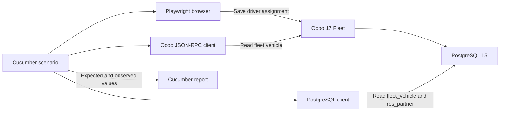

# Framework architecture

Cucumber expresses business workflows and rules in Gherkin. The driver-assignment scenario saves the
assignment in the real Fleet UI, reads the vehicle through Odoo JSON-RPC and independently reads the driver relationship
from PostgreSQL. The two read-back steps attach their expected and observed values to the same Cucumber result.

## Code and execution

- [Feature files](../features/) describe the workflow or rule. [Atomic steps](../src/steps/atomic/) expose shared actions
  and checks, [domain steps](../src/steps/domain/) implement module behavior and
  [composite steps](../src/steps/composite/) combine recurring workflows.
- [Page objects](../src/pages/) use [UI maps](../src/ui-map/) to navigate and save through the browser.
  [Fleet API adapters](../src/api/) prepare fixtures and read Odoo records. [Database queries](../src/db/queries.ts)
  use parameterized SQL.
- [Hooks](../src/support/hooks.ts) create fresh browser contexts for `@browser` scenarios and authenticate a separate
  JSON-RPC client for `@odoo-api` scenarios. Apply both tags when a workflow uses both paths. PostgreSQL and
  REST clients initialize on first use. Browser login remains a Gherkin step. Cleanup runs for any resources
  the scenario acquired, including when setup fails.
- Use native Playwright Test where browser assertions and test-scoped fixtures express the check directly.
  The [discard-driver test](../tests/driver-assignment.spec.ts) uses a typed API fixture to seed, read back and clean
  up its vehicle and drivers. The [health and login specs](../tests/smoke.spec.ts) run independently of that fixture.
  The [CI workflow](../.github/workflows/ci.yml) runs both runners and retains their HTML reports.

## Concurrency

`@serial` gives a scenario exclusive access to the workers in **one Cucumber invocation**. Independent runs
can still collide on fixed plates and partner names, change table-wide counts, and share server settings and
login lockouts by source address. Use a dedicated demo stack per independent full run when these checks overlap.
The native discard test uses unique vehicle and driver records and tears down by fixture IDs. It can run
alongside another invocation of that same test on the demo stack.

## Simulated and deployment-specific paths

- HOS tests use a simulated ELD, virtual clock and local rules. [HOS feature](../features/integration/hos_compliance.feature)
- CTI call events are simulated in memory or injected over a mocked WebSocket. The screen-pop check also needs a
  CTI-enabled Odoo frontend and a matching contact. [CTI strategy](CTI_STRATEGY.md)
- Offline vehicle sync uses in-memory PouchDB. The separate browser POD scenario needs a Loads/POD frontend and a
  status API. Tablet Fleet checks use browser viewport and orientation changes. [Mobile strategy](MOBILE_STRATEGY.md)
- Finance calls a configured external REST service and compares its response with local reference calculators.
  The stock Compose stack supplies Odoo Fleet and PostgreSQL. [API testing](API_TESTING.md)
